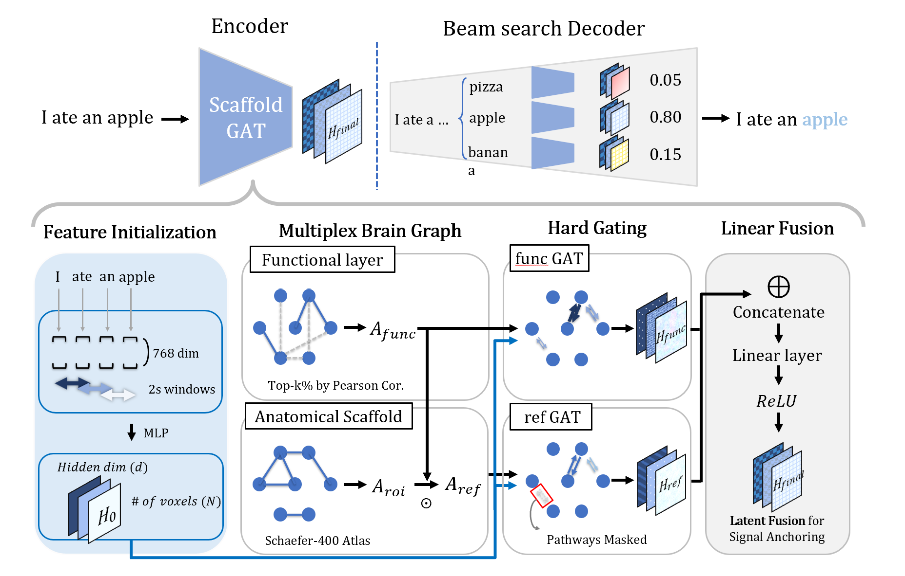

# Scaffold-GAT: Grounding Brain Dynamics in Neural Anatomy

**🎉 Official Repository for the paper accepted to the ACM SIGKDD 2026 Undergraduate Consortium**

<div align="center">
  
</div>

This repository contains the official implementation of **Scaffold-GAT**, a multiplex graph learning framework designed for neural language encoding from functional Magnetic Resonance Imaging (fMRI).

## Overview

Scaffold-GAT addresses the limitations of traditional voxel-wise linear models and unconstrained Graph Neural Networks (GNNs) by explicitly anchoring dynamic functional signals onto a stable anatomical scaffold. By modeling the brain as a multiplex network, the framework achieves state-of-the-art performance in reconstructing natural language from neural activity.

### Key Features
* **Multiplex Brain Graph**: Separates anatomical and functional dependencies into distinct topological layers to prevent "relational blurring".
* **Structural Gating**: Implements a hard-gating mechanism that uses anatomical priors to regularize functional message passing, ensuring biologically plausible information flow.
* **Hybrid Loss Function**: Optimizes both signal amplitude (via MSE) and temporal dynamics (via Pearson correlation).
* **Biological Alignment**: The model reaches peak performance when its spatial scale aligns with the core language network ($N \approx 2,000$ voxels).

---

## Methodology

Scaffold-GAT operates through three core mechanisms to ensure robust neural representation learning even in data-scarce and high-noise environments:

1. **Multiplex Brain Graph Construction**: We model the brain network by separating functional connectivity (dynamic synchronization) and anatomical constraints (physical topology based on the Schaefer-400 atlas) into distinct layers.
2. **Hard Gating**: During message passing, the model strictly suppresses anatomically implausible information pathways. By explicitly masking out unvalidated edges, it prevents noise from being detected as valid signals.
3. **Linear Fusion**: After independent message passing, the functionally and anatomically derived latent representations are integrated via late linear fusion, preserving relation-specific features while anchoring transient dynamics to a stable structural scaffold.

---

## Attribution & Baseline

This project is built upon and extends the semantic decoding framework originally developed by **Tang et al. (2023)**. We acknowledge the authors for their foundational work and for providing the open-source codebase that served as the baseline for our research:

* **Original Paper**: [Semantic reconstruction of continuous language from non-invasive brain recordings](https://www.nature.com/articles/s41593-023-01304-9) (Nature Neuroscience, 2023)
* **Original Repository**: [Semantic Decoding](https://github.com/ut-huth-lab/semantic-decoding) 

Scaffold-GAT introduces a multiplex graph learning approach and structural gating mechanisms to further improve the robustness and biological alignment of this baseline framework.

---

## Installation & Data Preparation

1. **Environment**: Ensure you have Python 3.x and PyTorch installed.
2. **External Data**: 
   * Extract GPT language model data into `data_lm/`.
   * Place training and test fMRI responses in `data_train/` and `data_test/` respectively.
3. **ROIs**: Subject-specific ROI files (e.g., `s3.json`) must be present in `data_train/ROIs/`.

---

## Execution Pipeline

### 1. Graph Construction
Build the initial functional and anatomical adjacency matrices.
```bash
# Construct functional connectivity graph
python3 decoding/build_graph.py --subject [SUBJECT_ID] --threshold 0.6

# Construct ROI-based anatomical graph
python3 decoding/build_roi_graph.py --subject [SUBJECT_ID]
```

### 2. Graph Refinement
Refine the anatomical scaffold using functional synchronization (Hadamard product masking).
```bash
python3 decoding/refine_roi_graph.py --subject [SUBJECT_ID] --top 20
```
### 3. Training the Scaffold-GAT
Train the encoding model using the updated hybrid loss function (MSE + Pearson).
```bash
python3 train_MGAT.py --subject [SUBJECT_ID] --batch_size 2 --lambd 0.5
```
### 4. Language Reconstruction (Decoding)
Reconstruct stimulus narratives from held-out brain responses.
```bash
python3 decoding/run_decoder_MGAT.py --subject [SUBJECT_ID] --experiment perceived_speech --task [TASK_NAME]
```
### 5. Evaluation
Assess reconstruction quality using BERTScore and other linguistic metrics.
```bash
python3 decoding/evaluate_predictions_GAT_func.py --subject [SUBJECT_ID] --experiment perceived_speech --task [TASK_NAME]
```
## Performance Summary
The framework achieves a BERTScore of 0.8259, significantly outperforming standard linear baselines (0.8116) and unconstrained GAT models (0.7997). Our analysis confirms that anchoring functional signals to a stable anatomical substrate provides the necessary inductive bias to overcome extreme fMRI data scarcity.

## Citations
If you find our work or this repository useful in your research, please consider citing our paper:
```bash
@inproceedings{kim2026scaffold,
  author = {Kim, Beomjin and Lim, Sungsu},
  title = {Scaffold-GAT: Grounding Brain Dynamics in Neural Anatomy},
  booktitle = {Proceedings of the 32nd ACM SIGKDD Conference on Knowledge Discovery and Data Mining (KDD '26)},
  year = {2026},
  publisher = {ACM},
  address = {New York, NY, USA}
}
```
